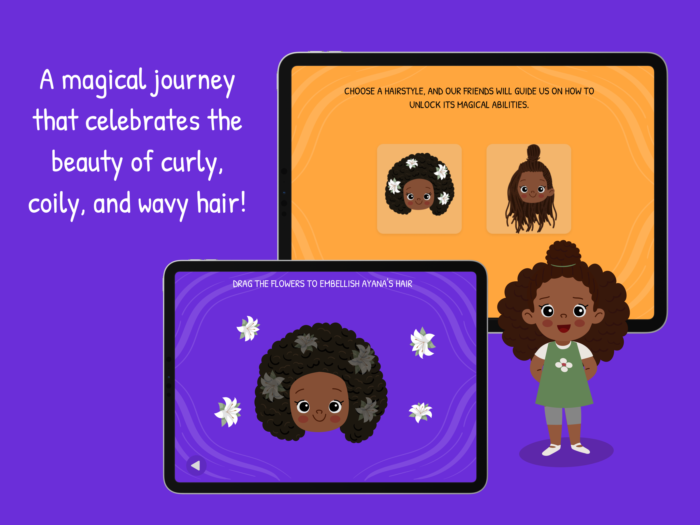
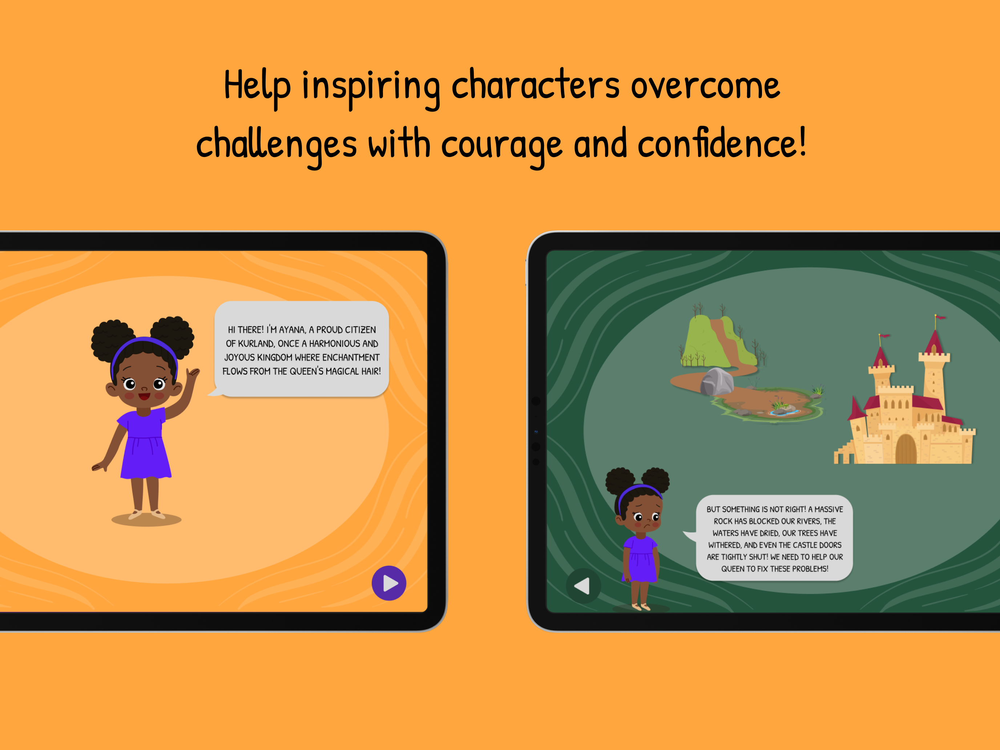
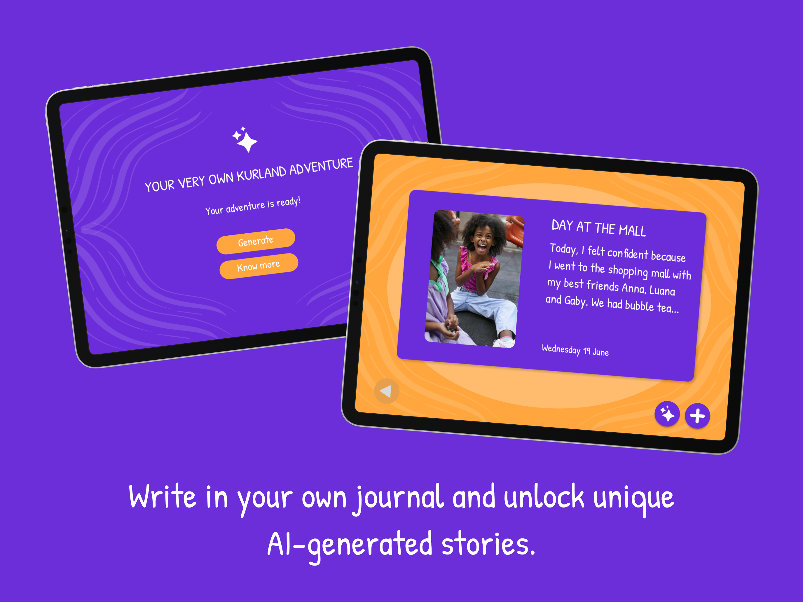

# Kurland

**Winner of Apple's Swift Student Challenge 2024**

Kurland is an interactive iOS experience designed to help build self-esteem in children with curly, coily, and wavy hair.

  

## The Experience

Kurland takes children on a magical journey through interactive activities that celebrate their hair and encourage confidence and self-esteem.

  

## Beyond the Adventure

Children can also express themselves through a personal journal and unlock unique AI-generated stories.

  

